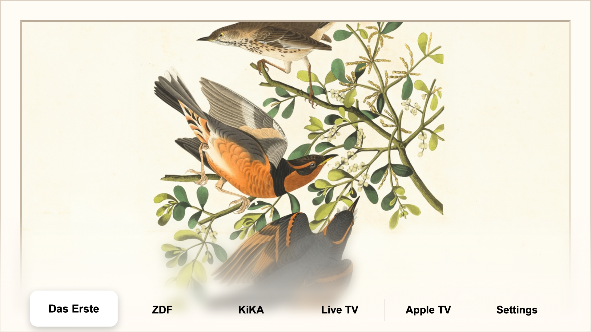

# Art TV

A quiet, artwork-first app for **Sony BRAVIA 4K GB ATV3**, running **Android TV 9 / API 28**.
Designed around this TV's 1920 x 1080 interface and its existing Sony TV player.
This project contains only the Sony artwork experience, not a general-purpose replacement launcher.



*Desktop design preview of this project's UI. TV playback is intentionally unavailable in the preview.*

Also see the [idle artwork](docs/home-preview.png) and [settings gallery](docs/settings-preview.png).

## What it does

- Ten bundled, offline backgrounds: the Mediterranean design and nine supplied images, with source credits.
- Equal framing on all four sides and an eight-pixel bevel at 1080p.
- A hidden bottom menu: **Das Erste, ZDF, KiKA, Live TV, Apple TV, Settings**.
- The first arrow or OK press reveals the menu without activating anything.
- After 20 seconds without interaction, the menu disappears and the artwork is sharp again.
- Blur and a warm veil only behind the menu, fading upward; the top 65% remains sharp.
- Large bold text, a raised white focus card, and remote, mouse and accessibility support.
- Two-column settings with artwork thumbnails, German/English labels and a physical HDMI-port picker.
- Saved artwork and HDMI choices, restored whenever the app opens, including after a reboot.
- Sony channel shortcuts that discover current channel names and prefer HD.
- Temporary Android audio focus while the artwork or its settings are visible, released on exit.

**Apple TV means the HDMI-connected device, not a streaming app.**
The first use asks which HDMI port it is connected to. Change the binding in Settings.

## Specific to this Sony

The TV identifies itself as `BRAVIA 4K GB ATV3` on Android 9. Its stock launcher is
`com.google.android.tvlauncher/.MainActivity`, and its TV app is `com.sony.dtv.tvx`.
HDMI opens through Android's standard TV-input intent, as in the prototype.
The original Android channel provider was inaccessible, so the three named shortcuts use
Sony's paired local remote-control API instead of Android channel IDs.

Art TV (`io.happytobi.arttv`) can be the default Android Home app. Once selected, it handles the remote's
**Home** button and opens when Android goes to Home after a full boot. Sony firmware can still resume
the last input on wake from standby. Art TV does not disable Sony Home.
Open **Settings → Sony · Home Screen** in Art TV to visit the original launcher without changing the default.

### Use the remote's Home button on the BRAVIA 4K GB ATV3

This model's Android 9 firmware prefers Sony Home even when Art TV is installed. The optional
Home-button shortcut was confirmed on a BRAVIA 4K GB ATV3 with the physical remote:

1. On the TV, open **Settings → Device Preferences → Accessibility**.
2. Under **Services**, select **Art TV Home Button** (German: **Art TV – Home-Taste**) and turn it on.
3. Press **Home** on the remote to open Art TV.

To make **Home** open Sony Home again, turn the service off in the same menu. This shortcut
keeps Sony Home enabled, does not change the default launcher, and does not by itself start Art TV at boot.

The service only handles the Home key on this Sony model. It does not read screen content, record
keystrokes, or send them over the network. It is off until you enable it on the TV.

This separate package does not overwrite the development prototype or import its private preferences.
Choose your artwork and HDMI port once in the new app; they then remain saved until its data is cleared
or the app is uninstalled.

### Open Art TV after a restart

On the BRAVIA 4K GB ATV3 running Android 9, open **Settings** inside Art TV and turn **Open at startup**
on (German: **Beim Start öffnen**). It is off by default and independent of the remote shortcut.
If the Home-button shortcut is enabled too, Art TV can open sooner when Android connects that service.
On the tested BRAVIA, it opened about 35 seconds into the reboot with the shortcut enabled, compared
with about 80 seconds using Android's startup notification alone.
Sony Home remains the default launcher and may appear first. Art TV only launches automatically when the TV
is awake and unlocked, not on standby wake. Turn **Open at startup** off to stop automatic launch.

### Hardware screenshot


*Actual 1920 x 1080 capture from the Sony during development of the earlier prototype.
It demonstrates the native framed artwork. It is not a claim that this new standalone APK
has already been installed. The menu screenshot above is the current desktop design preview.*

The named Sony channel jumps were verified on this TV during prototype testing.
The standalone package, bottom-menu blur, frame, and settings layout were checked on the Sony BRAVIA 4K GB ATV3.
HDMI audio-focus behavior still needs a live playback trial.
Audio focus asks cooperative players to pause their background sound; it does not pause an external HDMI device
or globally mute the TV.

## Build on the Mac

Requirements: **JDK 17**, Python 3, and Android SDK **build-tools 34.0.0** plus **android-34**.
Node.js and Git are needed only for the checks. No Gradle, Android libraries or npm packages are used.

```bash
# Point these at your installed tools. A portable JDK 17 works too.
export JAVA_HOME="$(/usr/libexec/java_home -v 17)"
export ANDROID_HOME=/opt/homebrew/share/android-commandlinetools

[ -f config.properties ] || cp config.example.properties config.properties
# Edit sony_tv_url in config.properties to this TV's current private LAN address.
bash build.sh
```

The result is **`ArtTV.apk`**. Configuration allows only `sony_tv_url`; no weather, movie, cloud
or account keys are needed. Plain HTTP is allowed only for the configured local TV host.

The first build creates `art-tv.keystore` and `.keystore-password`, both private and git-ignored.
**Back up both files.** Keep using the same key for updates; a differently signed APK cannot update an existing installation.
Never commit the signing files, `config.properties`, channel exports, generated output or APKs.
Commit `config.example.properties`, not your local copy. Keep the APK from your personal build off
GitHub Releases too: it embeds your configured TV address.

## Pair and export channels

Pair Art TV once before using the **Das Erste**, **ZDF**, or **KiKA** shortcuts. If Sony shows a
pairing pop-up or the shortcut can't open a channel, complete the steps below. This is separate from
ADB authorization, and pairing an earlier prototype does not pair Art TV.

With the TV on, open Terminal in the project directory. Replace `192.168.1.50` with the same TV
address you set in `sony_tv_url` before building (do not add the ADB port `:5555`):

```bash
python3 tools/sony_channels.py 192.168.1.50
```

Allow **Art TV channel lookup** on Sony's pairing screen and enter the displayed PIN in Terminal,
not in chat or `config.properties`. The PIN is hidden and never saved. If the script reports that
Art TV is already paired and the TV shows no PIN, press Enter. Once the script finishes, return to
Art TV and select a channel shortcut again.

The script exports the complete channel list to `sony-channels.local.json`. It verifies pagination
against Sony's counts, writes an atomic private file, and never changes the channel.
Use `--output another.local.json` for another destination or `--force` to replace an existing complete export.
For custom exports or TV backups inside the project, use the ignored `local/` folder (create it first)
or keep the `.local.json` suffix for exports so Git ignores them.
PINs and authentication cookies stay in memory. Redirects are refused.

The current three buttons discover channels by name rather than reading the export.
Their exact native DVB URI comes from Sony, not a hardcoded channel number.
The export is retained for later shortcut configuration; there is no JSON shortcut editor yet.

## Install on the Sony

After building, leave the Sony awake and enable USB debugging if needed. With Android platform-tools
on your Mac, run this from the project directory using the TV's current address. Accept the TV's
debugging authorization prompt if it appears, then rerun the command if needed.

```bash
./install.sh YOUR_TV_IP:5555
```

The installer checks the Sony model, installs or updates `ArtTV.apk` without clearing its data,
then opens Art TV and sets it as the default Home app. It verifies Android's Home resolution and
does not disable Sony Home. If the firmware refuses the change, the script reports the failure
and tries to restore Sony Home. Use `./install.sh --keep-home TV_IP:5555` to skip the default change.
Use the same signing key for updates. Every device command targets only the address you pass;
no root, ADB loopback approval, or debloat is needed.

**After installing:** [pair the channel shortcuts](#pair-and-export-channels) and, if you want the
remote's Home button to open Art TV, [enable the shortcut on the TV](#use-the-remotes-home-button-on-the-bravia-4k-gb-atv3).
The installer does not perform either step automatically: Sony pairing requires the on-screen PIN,
and the Home-button service requires your approval in the TV's Accessibility settings.
To launch Art TV after a full reboot, [enable Open at startup](#open-art-tv-after-a-restart) inside Art TV.

### Open an existing installation

On the TV, press **Home** if Art TV is the default. If Sony Home is still the default, select
**Art TV** from **Apps**. Or, from a Mac with authorized ADB access:

```bash
adb connect YOUR_TV_IP:5555
adb -s YOUR_TV_IP:5555 shell am start -W -n io.happytobi.arttv/.HomeActivity
```

This opens the installed app without updating it or changing the default launcher. If ADB reports
`No route to host` on macOS while the TV is reachable, check **System Settings → Privacy & Security →
Local Network** for the terminal app, then retry. If the TV prompts for debugging authorization, accept
it on the TV.

### Start over with a clean install

```bash
./reinstall.sh YOUR_TV_IP:5555
```

Use the same Android SDK as for the build (`ANDROID_HOME`). The script verifies the signed APK and
checks the TV model before doing anything destructive. If Art TV is installed, type `REINSTALL`
when prompted to remove it and its saved artwork and HDMI selections from the TV's primary profile.
The script then installs and opens Art TV, and sets it as the default Home app. If it is not installed
yet, the script skips removal. It does not factory-reset the TV, disable Sony Home, or touch other apps,
channel pairing, or your local signing files. For updates that keep your choices, use `install.sh`.

### Restore Sony Home and previously disabled apps

```bash
./restore-tv.sh YOUR_TV_IP:5555          # Preview only
./restore-tv.sh YOUR_TV_IP:5555 --apply  # Type RESTORE to confirm
```

This is not a factory reset. The script re-enables only apps that are both currently disabled
and in `local/restore-packages.txt`, plus Sony Home itself if it is disabled. It restores Sony Home
as the default and opens it. It leaves unrelated disabled apps, installed apps, accounts, channels,
and app data alone. The rollback list is private and not included in Git; use one recorded for
your own TV, with one package name per line. This does not switch the older launcher prototype's
internal mode; if you activated that mode, first choose **Original** in its settings on the TV.

To restore **only** the default launcher without re-enabling any other apps:

```bash
adb connect YOUR_TV_IP:5555
adb -s YOUR_TV_IP:5555 shell cmd package set-home-activity --user 0 com.google.android.tvlauncher/.MainActivity
```

## Preview and checks

```bash
python3 tools/preview.py
# Open the printed file URL, or serve only on this computer:
python3 tools/preview.py --serve

bash tools/check.sh
```

The small browser preview is a design tool, not an LG/Samsung application and not Android execution.
It shares the artwork catalogue and layout, but cannot pair, tune channels, play HDMI or change the Sony.
Its browser preferences are separate from the TV's.

Checks build the APK, test channel matching and the exporter, validate packaged artwork and the app's
restricted manifest, and exercise settings navigation, saved choices, async artwork changes and the exact idle timeout.

## Script reference

Run these commands from the project directory. Replace `TV_IP` with the Sony's current LAN address.

| Command | What it does |
| --- | --- |
| `./build.sh` | Builds and signs `ArtTV.apk` locally. Does not contact the TV. |
| `./install.sh TV_IP:5555` | Installs or updates Art TV, opens it, and selects it as the default Home app. Preserves app data and keeps Sony Home enabled. Pass `--keep-home` before the address to skip changing the default. Requires ADB. |
| `./reinstall.sh TV_IP:5555` | Checks the signed APK, then offers to remove Art TV and its saved choices before reinstalling and opening it. Equivalent to `./install.sh --clean TV_IP:5555`. Requires ADB and the Android build-tools. |
| `./restore-tv.sh TV_IP:5555 [--apply]` | Previews restoration from `local/restore-packages.txt`. With `--apply` and confirmation, re-enables the recorded apps that are still disabled, restores Sony Home as the default, and opens it. Requires ADB. |
| `python3 tools/sony_channels.py TV_IP` | Pairs through Sony's PIN prompt and exports the channel list to `sony-channels.local.json`. Accepts `--output` and `--force`. Does not tune the TV. |
| `python3 tools/preview.py [--serve]` | Generates the offline preview in `out/preview/`. With `--serve`, serves it locally on port 8000 (override with `--port`). Does not contact the TV. |
| `bash tools/check.sh` | Builds the APK and runs the Java, Python, and browser-logic tests. Does not install anything on the TV. |
| `python3 tools/configure.py` | Build helper called by `build.sh`. Validates `sony_tv_url` and generates Java and Android network-security configuration under `out/` from `config.properties`. Not normally run directly. |

The test scripts in `tests/` are run by `tools/check.sh`: `ArtChannelNamesTest.java` checks channel-name
matching, `ProjectTest.py` checks packaging and Git exclusions, `SonyChannelsTest.py` checks channel export,
and `ArtSettingsTest.js` checks the browser preview's settings and navigation.

## Project layout

| Path | Purpose |
| --- | --- |
| `app/src/io/happytobi/arttv/` | Native artwork, settings, Sony playback, preferences and audio focus |
| `app/assets/art/` | The single artwork catalogue and ten bundled images |
| `app/assets/i18n/` | Only the English and German strings this app uses |
| `preview/` | Small, offline desktop design preview |
| `tools/` | Build configuration, local preview and private Sony channel export |
| `tests/` | Focused checks for the retained features |
| `docs/` | Screenshot assets |

Removed: other TV platforms and brands, classic launcher/shelf/recommendation code, weather/crypto widgets,
movie APIs, accounts, remote remapping/accessibility services, screensavers, sleep timers, updates,
system-app switching/debloat and their recovery machinery. No private TV dump, old signing key,
old configuration, repository history or SDK/JDK installation was copied.

## Artwork and origins

Tobi sourced nine of the ten bundled images from [Unsplash](https://unsplash.com/). Contributor credits
are shown in the picker and recorded alongside the original source filenames and stable IDs in
[`app/assets/art/catalogue.json`](app/assets/art/catalogue.json). The Unsplash images were resized to at most 1920 pixels on their longest side;
personal/source metadata was removed, and the original files were left untouched.
The bundled artwork is **not relicensed under the code's MIT license**. Check each source's image rights
before publishing or redistributing it. The Mediterranean design was generated during the design session.

The idea and original code foundation came from [Free My TV](https://github.com/simbasjungles/free-my-tv),
via the [Sony development fork](https://github.com/HappyTobi/free-my-tv).
Art TV is a separate, Sony-focused extraction of the artwork changes developed in that fork.
The code remains MIT-licensed. The original contributors' copyright notice is retained in
[`LICENSE`](LICENSE) and included in the APK as required by that license.
